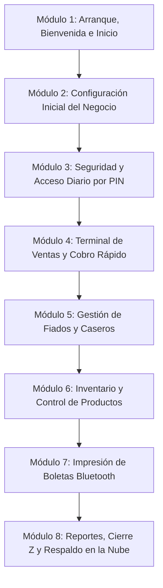
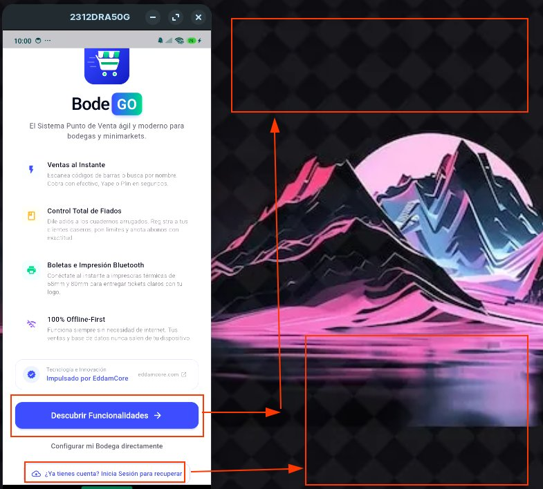

# BodeGO POS — Manual de Usuario Oficial

---

<!-- PORTADA DE PRESENTACIÓN -->
<div align="center">

# 🛒 BodeGO POS
### *El Sistema Punto de Venta ágil, moderno y confiable para bodegas y minimarkets*

---

**MANUAL OFICIAL DE OPERACIÓN Y GUÍA VISUAL PARA EL USUARIO FINAL**

**Versión del Sistema:** 1.0.0 (Compilación Release 2026)  
**Compatibilidad:** Android 14+ / Modo Offline-First y Respaldo en la Nube  
**Desarrollado y Distribuido por:** [EddamCore](https://eddamcore.com) — *Tecnología e Innovación para el Comercio*  
**Fecha de Edición:** Noviembre 2026  

---

</div>

> [!NOTE]
> Este manual ha sido redactado para orientar a propietarios de negocios, administradores y personal de caja en el uso paso a paso de **BodeGo POS**, permitiendo una operación rápida, segura y sin interrupciones en el mostrador.

---

## 📑 Planificación y Estructura del Manual Completo

El manual se organiza en módulos didácticos que acompañan al usuario desde la instalación hasta el control avanzado del negocio:



1. **Módulo 1: Arranque y Pantalla de Bienvenida (Esta Entrega)**: Primer contacto, presentación institucional, tour educativo y recuperación de cuenta en la nube.
2. **Módulo 2: Asistente de Configuración Inicial (Wizard de 3 Pasos)**: Registro de datos de la bodega (nombre, RUC, dirección), creación del Administrador y asignación del primer Cajero con su PIN.
3. **Módulo 3: Acceso Diario y Seguridad**: Teclado numérico táctil para inicio de turno de cajero, cambio de contraseña de administrador y reasignación de PIN.
4. **Módulo 4: Módulo de Ventas (Punto de Venta)**: Búsqueda rápida de productos, escaneo de códigos de barra por cámara, carrito de compras y cobros en Efectivo, Yape y Plin.
5. **Módulo 5: Libreta Digital de Fiados**: Registro de clientes caseros, topes máximos de crédito, historial de compras al crédito y registro de amortizaciones o abonos parciales/totales.
6. **Módulo 6: Catálogo e Inventario**: Registro de productos con precio de costo y venta, alertas de stock mínimo y control de existencias sin internet.
7. **Módulo 7: Conectividad e Impresión**: Emparejamiento Bluetooth con impresoras térmicas de 58mm y 80mm, personalización de logotipo y pie de ticket.
8. **Módulo 8: Cierre de Turno y Nube**: Cuadre de caja, corte Z, sincronización bidireccional automática con Google Sheets y Google Drive.

---

# Módulo 1: Ventana de Bienvenida e Inicio (`WelcomePresentationView`)

---

## 1.1. Hoja de Descripción Base de la Ventana

### ¿Qué es esta ventana?
La **Pantalla de Bienvenida** es la puerta de entrada principal de BodeGo POS. Aparece de manera automática en dos escenarios clave:
1. **Primer encendido:** Cuando el comerciante acaba de instalar la aplicación por primera vez en su dispositivo móvil.
2. **Reinicio de datos:** Si se borraron los datos de la app para transferir el sistema o comenzar desde cero.

### Propósito operativo
Brindar al bodeguero o comerciante una comprensión inmediata de las capacidades del sistema y ofrecerle **tres caminos de navegación claros**, asegurando que nunca se sienta perdido:

| Ruta | Botón en Pantalla | ¿Para quién está pensada? | Resultado al presionar |
| :--- | :--- | :--- | :--- |
| **Ruta 1: Aprendizaje** | **`Descubrir Funcionalidades ->`** | Usuarios nuevos que desean ver un resumen visual interactivo antes de ingresar datos. | Abre un carrusel dinámico de 4 diapositivas explicando ventas, fiados, tickets y cierre de caja. |
| **Ruta 2: Creación Directa** | **`Configurar mi Bodega directamente`** | Comerciantes que ya conocen el sistema o desean poner su tienda en marcha sin rodeos. | Abre de inmediato el formulario guiado (Nombre del negocio, Admin y Cajero). |
| **Ruta 3: Restauración Nube** | **`¿Ya tienes cuenta? Inicia Sesión para recuperar`** | Clientes que cambiaron de celular, formatearon su equipo o tienen un respaldo previo en la nube. | Despliega el modal de inicio de sesión con correo y contraseña para descargar automáticamente su catálogo completo. |

---

## 1.2. Desglose Visual y Explicación Detallada de la Ventana

A continuación se presenta la interfaz interactiva con sus zonas señalizadas conforme al esquema de uso:



---

### [ZONA 1] Encabezado, Conectividad y Acceso Rápido
Ubicada en la parte superior de la pantalla:

* **Badge "POS Oficial":** Identifica a la aplicación como la solución oficial autorizada para puntos de venta móviles de BodeGo.
* **Acceso Directo "Iniciar Sesión":** Permite al administrador acceder a la nube sin necesidad de desplazarse hasta el pie de página.
* **Ícono de Vinculación de Dispositivo Secundario:** Botón con animación de pulso que permite emparejar este teléfono con una terminal principal o enlazar un escáner secundario mediante red local o código QR.
* **Isotipo Oficial BodeGo:** Logotipo característico con el carrito de compras dinámico y el título tipográfico en gradiente azul y verde esmeralda.
* **Lema Institucional:** *"El Sistema Punto de Venta ágil y moderno para bodegas y minimarkets."*

---

### [ZONA 2] Los 4 Pilares Fundamentales de BodeGo
Cuatro tarjetas compactas con íconos temáticos que resumen la propuesta de valor:

1. **⚡ Ventas al Instante:**
   - Permite cobrar usando la cámara del teléfono como escáner de códigos de barra o ingresando el nombre del producto en el buscador predictivo.
   - Cobra en segundos combinando Efectivo, billeteras digitales (Yape / Plin) o tarjetas.
2. **📖 Control Total de Fiados:**
   - Reemplaza el cuaderno físico tradicional de deudas por una libreta electrónica exacta.
   - Registra caseros por nombre o teléfono, asigna un límite de crédito para evitar sobreendeudamientos y calcula el saldo pendiente al centavo.
3. **🖨️ Boletas e Impresión Bluetooth:**
   - Conexión sin cables con impresoras térmicas portátiles de 58 mm o de mostrador de 80 mm.
   - Emite tickets de venta legibles con el nombre del negocio, RUC, dirección, detalle de productos y mensaje de despedida.
4. **📶 100% Offline-First (Sin necesidad de Internet):**
   - Garantía de continuidad comercial: la aplicación no se detiene si no hay señal celular o Wi-Fi. Todos los registros se guardan en la memoria local ultra-rápida (Isar Database).

---

### [ZONA 3] Respaldo Tecnológico e Información Legal
* **Insignia "Impulsado por EddamCore":** Tarjeta interactiva que certifica el respaldo de ingeniería de software. Al pulsar sobre ella, el usuario puede consultar:
  - Información de contacto y portal web oficial (`eddamcore.com`).
  - Términos y condiciones de uso del servicio.
  - Políticas de privacidad y garantía de no venta de datos comerciales a terceros.

---

### [ZONA 4] Botón Primario: "Descubrir Funcionalidades"
> **Aspecto:** Botón grande de color azul royal (`#4353FF`) con texto en blanco y flecha indicadora.

* **Función:** Es la acción recomendada para el usuario que recién descarga la app.
* **Al pulsarlo:** Despliega una animación que conduce a las 4 diapositivas del **Tour de Inducción**:
  1. *Catálogo y Cobro Ágil*.
  2. *Libreta de Fiados*.
  3. *Impresión de Boletas*.
  4. *Cuadre Z y Finanzas*.
* Cada diapositiva contiene ilustraciones y textos simples pensados para el personal de mostrador.

---

### [ZONA 5] Enlace Secundario: "Configurar mi Bodega directamente"
> **Aspecto:** Texto subrayado o botón sobrio sin fondo para no distraer del botón principal.

* **Función:** Atajo para el comerciante experimentado que no requiere ver el tutorial inductivo.
* **Al pulsarlo:** Abre de inmediato el **Paso 1 del Asistente**:
  - Ingreso de la Identidad Comercial (Nombre de la tienda, dirección y RUC).

---

### [ZONA 6] Botón Destacado: "☁ ¿Ya tienes cuenta? Inicia Sesión para recuperar"
> **Aspecto:** Botón de estilo contorno (outline) con el ícono de la nube azul en la parte inferior de la pantalla.

* **Función:** **Herramienta de rescate y continuidad de negocio.**
* **¿Cuándo utilizarlo?**
  - Si el comerciante adquirió un nuevo teléfono celular o tablet.
  - Si tuvo que restablecer de fábrica su dispositivo.
  - Si reinstaló la aplicación y necesita recuperar todos sus productos y caseros.
* **Al pulsarlo:**
  - Abre el modal flotante **Iniciar Sesión**.
  - El usuario ingresa su **Correo de Administrador** (ejemplo: `deividlima762@gmail.com`) y su **Contraseña**.
  - El sistema se conecta encriptadamente a su hoja de Google Sheets / Google Drive y descarga todo el catálogo, clientes y configuraciones de inmediato.

---

## 1.3. Resumen Rápido para el Usuario en Mostrador

```
┌─────────────────────────────────────────────────────────────────┐
│               ¿QUÉ BOTÓN DEBO ELEGIR AL INICIAR?                │
├─────────────────────────────────────────────────────────────────┤
│ • ¿Es tu primera vez usando BodeGo?                             │
│   👉 Toca "Descubrir Funcionalidades"                           │
│                                                                 │
│ • ¿Quieres configurar tu tienda de inmediato?                   │
│   👉 Toca "Configurar mi Bodega directamente"                   │
│                                                                 │
│ • ¿Ya tenías tu bodega registrada y cambiaste de celular?       │
│   👉 Toca "Inicia Sesión para recuperar"                        │
└─────────────────────────────────────────────────────────────────┘
```

